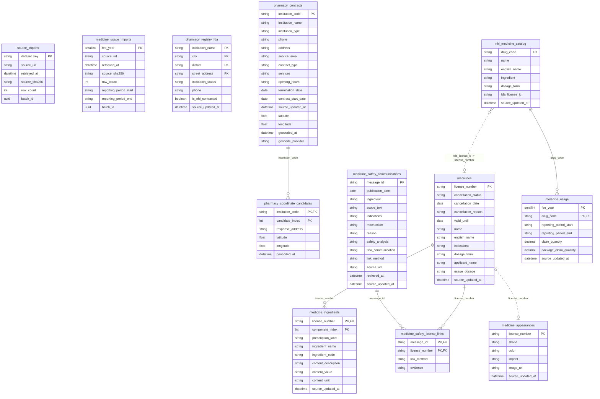

# MediMate 實體關聯圖（ERD）

## Chen 表示法圖檔

依附件範例的 Chen ERD 符號製作：

[開啟 Chen ERD 圖檔](./entity-relationship-diagram-chen.svg)

圖中矩形代表實體、橢圓代表屬性、菱形代表關聯；主鍵以底線標示，正式外鍵以實線表示，程式邏輯 JOIN 以虛線表示。

以下 ERD 依 `db/migrations/001_catalog.sql` 至 `005_medicine_information.sql` 繪製。

- 實線關聯：資料庫 migration 明確定義的外鍵。
- 虛線關聯：目前程式以識別碼進行邏輯 JOIN，但 migration 未宣告外鍵。
- `source_imports` 與 `medicine_usage_imports` 是匯入批次紀錄，沒有直接連到業務資料表的外鍵。

## 關聯說明

| 關聯 | 類型 | 說明 |
|---|---|---|
| `pharmacy_contracts` → `pharmacy_coordinate_candidates` | 一對多，正式 FK | 一間藥局可有多個 TGOS 候選座標。 |
| `medicines` → `medicine_ingredients` | 一對多，正式 FK | 一張藥品許可證可有多筆處方成分。 |
| `medicine_safety_communications` → `medicine_safety_license_links` | 一對多，正式 FK | 一則安全公告可精確關聯多張許可證。 |
| `medicines` → `medicine_safety_license_links` | 一對多，正式 FK | 一張許可證可對應多則安全公告。 |
| `nhi_medicine_catalog` → `medicine_usage` | 一對多，正式 FK | 一個健保藥品代碼可有多個費用年度使用量。 |
| `nhi_medicine_catalog` → `medicines` | 邏輯關聯 | 透過 `fda_license_id = license_number`，目前未宣告 FK。 |
| `medicines` → `medicine_appearances` | 邏輯關聯 | 透過 `license_number` JOIN；目前 migration 未宣告 FK。 |

